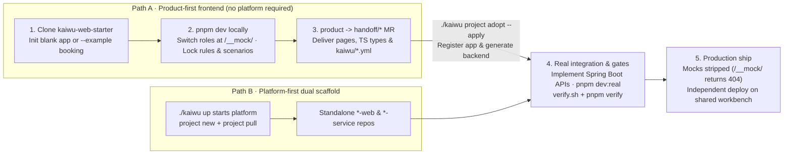
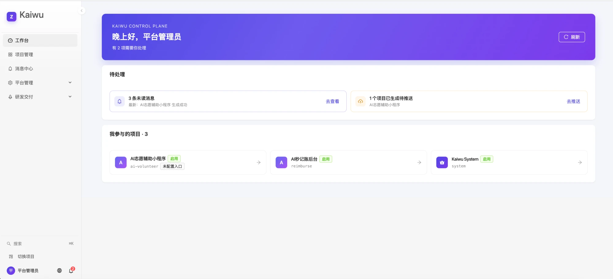
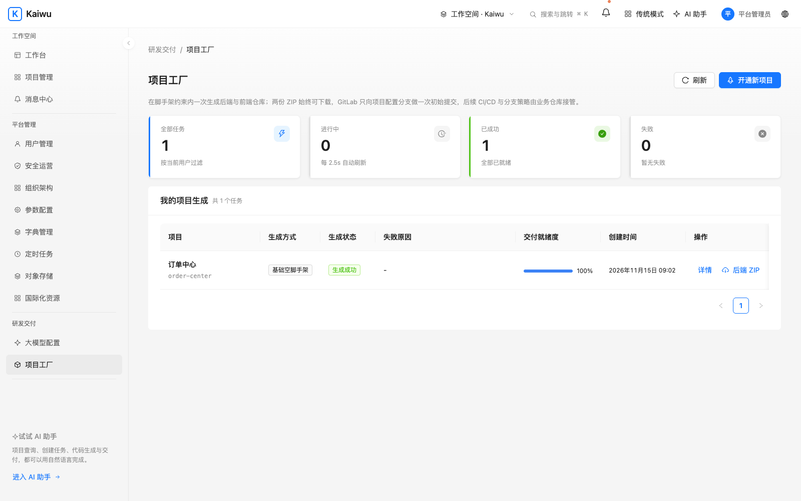
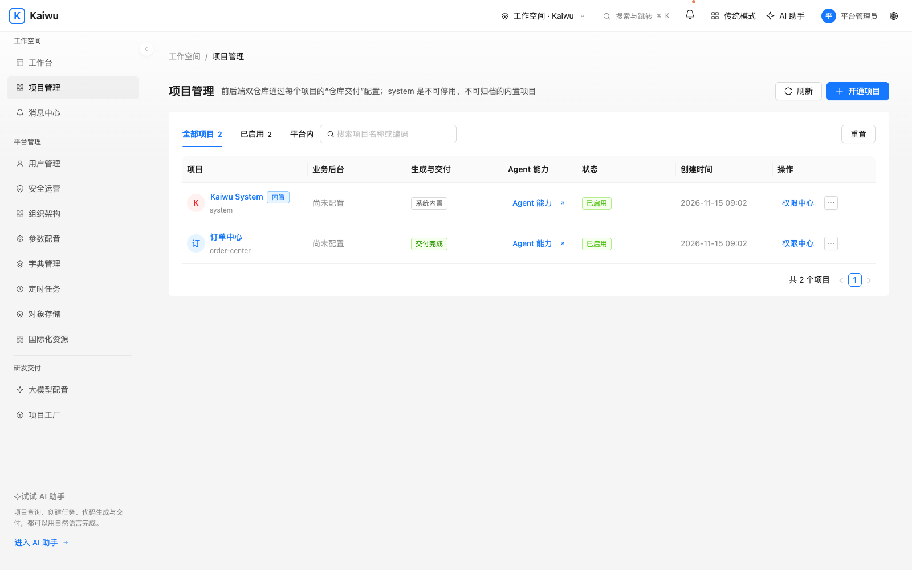
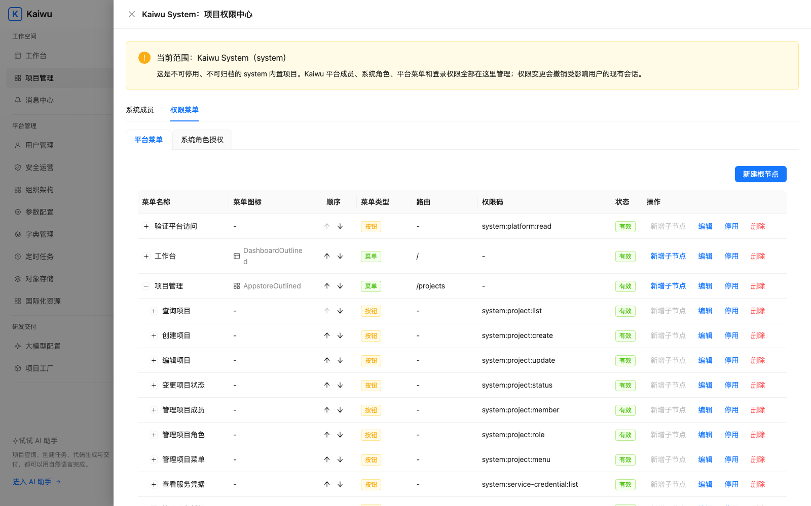
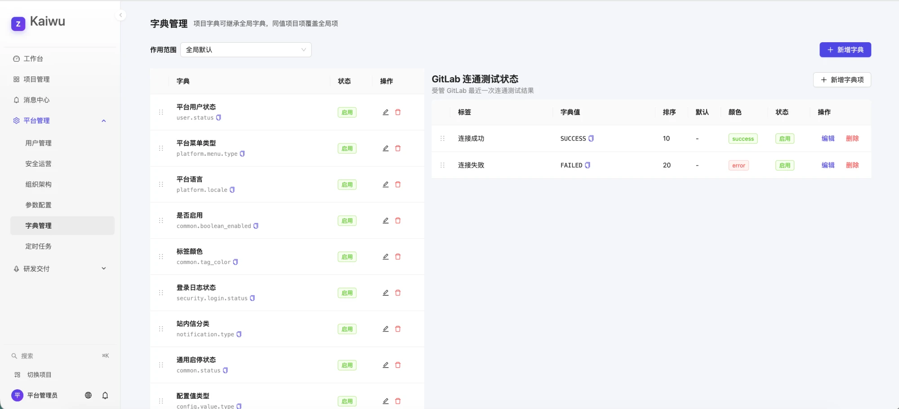
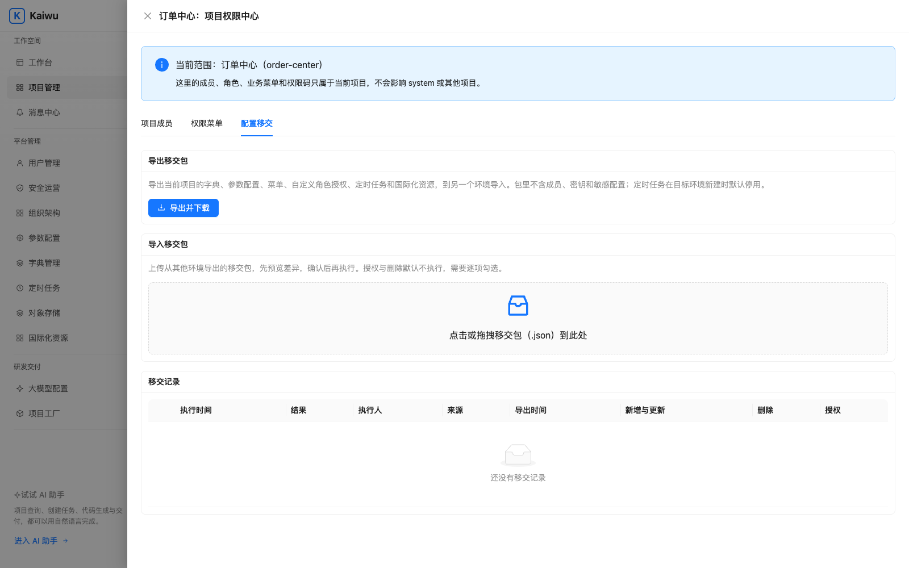
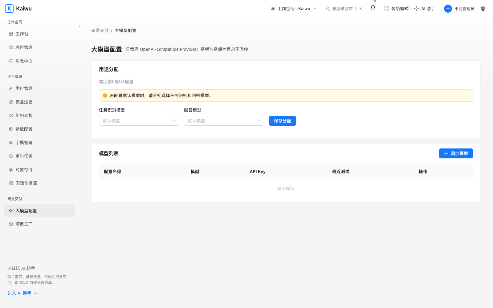

<div align="center">

# Kaiwu · 开物载道

**Product & AI build the real frontend. Backend engineers wire APIs and ship — on a shared enterprise core.**

[中文](README.md) · [v0.3.0 Release](https://github.com/kaiwuzaidao/kaiwu/releases/tag/v0.3.0) · [Frontend Starter](https://github.com/kaiwuzaidao/kaiwu-web-starter/tree/v0.3.0) · [AI Collaboration Guide (ZH)](docs/AI-DEVELOPMENT.md) · [How Kaiwu Works (ZH)](docs/HOW-IT-WORKS.md)

</div>

> **Why Kaiwu?**
> Teams building multiple internal back-office apps (purchasing, inventory, booking, order workflows) repeatedly hit two walls: **rebuilding product prototypes from scratch in frontend code**, and **AI coding assistants drifting across repositories or skipping permissions and migrations**. Kaiwu solves both with **Product-led Frontends + In-repo Guardrails + a Thin Shared Platform**.

| Product-Led Frontend (Zero Rewrite) | Controllable Delivery (Zero Drift) | Thin Platform (Shared Enterprise Core) |
| --- | --- | --- |
| Product managers and AI build working **React pages** with built-in multi-persona `/__mock/` demos in `kaiwu-web-starter`. Once approved, `./kaiwu project adopt` generates the companion backend—and the exact same frontend ships. | Every business app lives in **standalone frontend & backend repos** with `AGENTS.md`, numbered business rules, executable scenarios, and `verify` gates that catch missed permissions, rules, or mocks before review. | Gateway, SSO, project members/roles, row-level data scopes, managed dictionaries, i18n, object storage (STS), unified tasks, and a guarded AI assistant are governed once while apps deploy independently. |

---

## From Mock to Production in One Glance





---

## How Kaiwu Compares

| Dimension | Kaiwu + AI Coding Agent | Low-Code Platform | Traditional Starter Kits | AI Coding Agent Alone |
| --- | --- | --- | --- | --- |
| **Prototype to production** | Product builds the real React frontend with `/__mock/`, adopts via CLI, and engineers wire APIs via `dev:real`—**zero rewrite**; UI library is swappable | Drag-and-drop forms publish quickly, but complex UX and custom frontend reuse hit platform walls | Product draws wireframes; frontend engineers rebuild every screen and realign DTOs | Fast throwaway demos, but missing shared auth, permission wiring, and mock isolation force rewrites |
| **Second app reuse** | Connect the new app to the same Gateway and assign project roles & row scopes to existing staff | Apps inside the same workspace usually share accounts and roles | Each copy duplicates login tables; unifying SSO and task inboxes takes custom rework | Every prompt must re-explain auth APIs, token protocols, and permission tables |
| **Long-term control** | Small per-app context + linked rules/scenarios/mocks + three-way permission parity checks | Visual config limits code-first review and automated regression tests | Copied repos diverge quickly; shared fixes must be manually ported | Permission parity, migrations, redaction, and release contracts fall on manual discipline |

---

## Quick Start: Pick Your Path

### Product-first mock demo

> **Path A (Recommended to try first) · Requires only Git, Node 22, and pnpm 10**—spin up an interactive two-user equipment booking demo locally in minutes without Docker, MySQL, or JDK:

<details>
<summary>Copy this prompt into Claude Code, Codex, or Cursor to start immediately</summary>

```text
Initialize an equipment booking demo from https://github.com/kaiwuzaidao/kaiwu-web-starter (v0.3.0), follow AGENTS.md to start the local mock server, and give me the /__mock/ persona-switcher URL to test.
```

</details>

Or run directly in your terminal (drop `--example booking` for a clean blank app):

```bash
git clone --branch v0.3.0 --depth 1 https://github.com/kaiwuzaidao/kaiwu-web-starter.git
cd kaiwu-web-starter
node scripts/kaiwu-init.mjs --code equipment-booking --name "Equipment Booking" --example booking
cd ../equipment-booking-web
pnpm install --frozen-lockfile
pnpm dev
```

1. **Test across personas**: Open `/__mock/` on the printed local URL across two browser sessions to test booking, conflict alerts, cancellation release, and in-memory reset.
2. **Swappable UI & contract gates**: Business UI uses the read-only `@/kaiwu` layer (`useCan`, `useDict`, `useProjectConfig`, `kaiwuRequest`), letting you swap UI component libraries freely while `pnpm verify:mock` enforces parity across `docs/business-rules.md`, `docs/acceptance-scenarios.md`, `mock-support/`, and `kaiwu/*.yml`.
3. **Adopt & pair backend**: Hand off from `product` via `handoff/*` MR, then run in the platform entry repository:

```bash
./kaiwu project adopt ../equipment-booking-web
./kaiwu project adopt ../equipment-booking-web --apply
```

- Preview first (zero writes), then `--apply` to register the frontend, import manifests and initial `roles.yml`, and generate the companion `../equipment-booking-service` (`ADOPT_FRONTEND`).
- Once backend APIs are ready, test in the **same frontend** with `pnpm dev:real` (proxying `/api`, `/{code}-api`, and `/{code}-svc` to Gateway). Ongoing manifest sync uses `./kaiwu project sync ../equipment-booking-web`; optional Workflow apps use `./kaiwu workflow sync ../equipment-booking-web`.

---

### Run the full platform

> **Path B (v0.3.0) · Requires Git, Docker with Compose v2, OpenSSL, and curl**. Starts local MySQL and pulls prebuilt `amd64 / arm64` images from GHCR (Gitee mirror: `https://gitee.com/wujm12138/kaiwu.git`):

<details>
<summary>Copy this prompt into a terminal coding agent to boot Kaiwu and scaffold a project</summary>

```text
Get Kaiwu v0.3.0 from https://github.com/kaiwuzaidao/kaiwu and follow AGENTS.md to start it locally. Ask what I want to build, then set up its backend and frontend.
```

</details>

```bash
git clone --branch v0.3.0 --depth 1 https://github.com/kaiwuzaidao/kaiwu.git
cd kaiwu
./kaiwu doctor
KAIWU_DB_TYPE=mysql ./kaiwu up
```

- Open **<http://127.0.0.1:8000>**, sign in as `admin` with the printed random password, and change it when prompted (`./kaiwu credentials` shows initial credentials again; `./kaiwu down` stops while retaining volumes).
- Upgrading an existing DB or configuring DM8: [Upgrade guide (V128)](https://github.com/kaiwuzaidao/kaiwu-system-service/blob/v0.3.0/docs/UPGRADING.md) · [Database setup](https://github.com/kaiwuzaidao/kaiwu-system-service/blob/v0.3.0/docs/DATABASES.md) · [MySQL / DM8 SQL](https://github.com/kaiwuzaidao/kaiwu-system-service/releases/tag/v0.3.0).

#### Generate a dual-repo project

Using `order-center` as an example, create it in Project Management or via CLI:

```bash
./kaiwu login --client "kaiwu-demo"
./kaiwu project new order-center --name "Order Center"
./kaiwu project status order-center --wait
./kaiwu project pull order-center
./kaiwu project-up ../business/order-center-service ../business/order-center-web
```



<details>
<summary>More platform screens (Projects, Permissions, Dictionaries, Config Handover, Model Routing)</summary>

- **Project Management**: Central registry for built-in `system` and business apps  
  
- **Permission Center**: Menu tree and three-part permission codes matching `@RequirePermission` and `kaiwu/menus.yml`  
  
- **Managed Dictionaries & Data Scopes**: Stable values stored in DB, localized labels served by platform  
  
- **Cross-Env Config Handover**: Diff preview for additions, changes, removals, and role grants  
  
- **Model Routing**: Independent PLAN and ANSWER model bindings  
  

</details>

---

## Shared Enterprise Capabilities

| Capability | What it provides | Docs |
| --- | --- | --- |
| **Access & Row-Level Data Scopes** | SSO + signed 60s Gateway Context; MyBatis-Plus row filtering (self / dept / custom depts) | [Project access](https://github.com/kaiwuzaidao/kaiwu-system-service/blob/v0.3.0/docs/PROJECT_ACCESS.md) · [Data scopes](https://github.com/kaiwuzaidao/kaiwu-system-service/blob/v0.3.0/docs/DATA_SCOPE.md) |
| **Frontend Adoption & Config Handover** | `project adopt` frontend onboarding, `project sync` for `kaiwu/*.yml`, cross-env config packages | [ADR 0048](https://github.com/kaiwuzaidao/kaiwu-system-service/blob/v0.3.0/docs/adr/0048-adopt-existing-frontend.md) · [Project factory](https://github.com/kaiwuzaidao/kaiwu-system-service/blob/v0.3.0/docs/PROJECT_FACTORY.md) |
| **Unified Tasks & Inbox** | Business services open, update, and close tasks by `bizKey`; assignees act from the workbench | [Unified tasks](https://github.com/kaiwuzaidao/kaiwu-system-service/blob/v0.3.0/docs/UNIFIED_TODO.md) |
| **Object Storage (STS) & Excel** | Prefix-scoped temporary credentials for storage; optional XLSX import/export validation | [Starter repository](https://github.com/kaiwuzaidao/kaiwu-system-starter/tree/v0.3.0) |
| **Guarded Project Assistant** | Two-stage PLAN / ANSWER routing, permission-scoped reads, preview-before-write confirmation | [Model routing ADR](https://github.com/kaiwuzaidao/kaiwu-system-service/blob/v0.3.0/docs/adr/0043-agent-multi-model-routing.md) · [Project actions](https://github.com/kaiwuzaidao/kaiwu-system-service/blob/v0.3.0/docs/adr/0030-agent-cross-project-capabilities.md) |

> **Maven Central (`com.kaiwuzaidao`)**: Business backends in `v0.3.0` continue to use version `0.2.0` of `kaiwu-system-starter`, `kaiwu-data-scope`, and `kaiwu-excel`.

---

## Repository Map & Further Reading

| Repository | Role |
| --- | --- |
| [kaiwu](https://github.com/kaiwuzaidao/kaiwu) | Unified open-source entry & CLI orchestration ([Gitee mirror](https://gitee.com/wujm12138/kaiwu)) |
| [kaiwu-web-starter](https://github.com/kaiwuzaidao/kaiwu-web-starter/tree/v0.3.0) | Zero-platform product frontend starter (`/__mock/`, rule/scenario gates, headless `@/kaiwu`) |
| [kaiwu-system-service](https://github.com/kaiwuzaidao/kaiwu-system-service/tree/v0.3.0) | Control plane backend, Project Factory, frontend adoption, Flyway & Helm Chart |
| [kaiwu-gateway-service](https://github.com/kaiwuzaidao/kaiwu-gateway-service/tree/v0.3.0) | Single external API gateway, JWT/Redis session validation & signed Context |
| [kaiwu-system-web](https://github.com/kaiwuzaidao/kaiwu-system-web/tree/v0.3.0) | Workbench, permission center, dictionaries/config/i18n & Project Factory UI |
| [kaiwu-system-starter](https://github.com/kaiwuzaidao/kaiwu-system-starter/tree/v0.3.0) | Java backend SDK, row-level data scopes & Excel utilities |
| [kaiwu-deploy](https://github.com/kaiwuzaidao/kaiwu-deploy/tree/v0.3.0) | Optional Kubernetes / Argo CD GitOps manifests (`./kaiwu deploy-init`) |

- **Guides & Deployment**: [AI Guide (ZH)](docs/AI-DEVELOPMENT.md) · [How Kaiwu Works (ZH)](docs/HOW-IT-WORKS.md) · [Repositories (ZH)](docs/REPOSITORIES.md) · [Single-Server Deployment](https://github.com/kaiwuzaidao/kaiwu-system-service/blob/v0.3.0/docs/SERVER-DEPLOYMENT.md) · [Kubernetes](https://github.com/kaiwuzaidao/kaiwu-system-service/blob/v0.3.0/docs/KUBERNETES.md)
- **Project Governance**: [Agent Guide](AGENTS.md) · [Changelog](CHANGELOG.md) · [Contributing](CONTRIBUTING.md) · [Apache-2.0](LICENSE) · [Trademark Policy](TRADEMARKS.md#trademark-policy-english)
