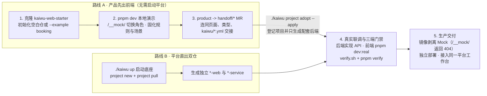
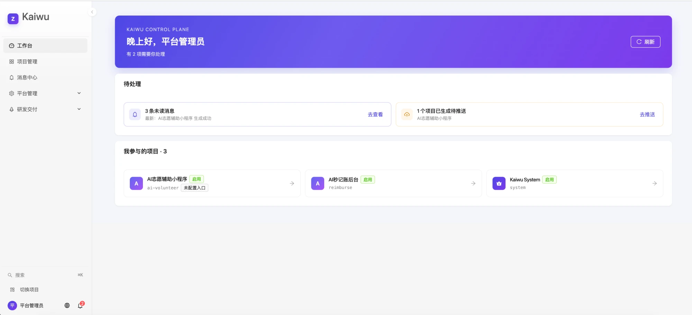
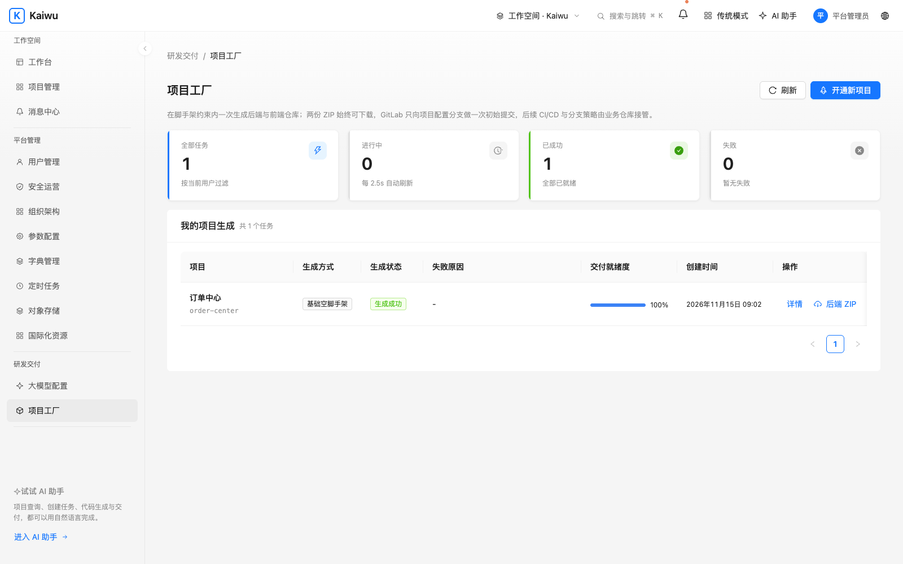
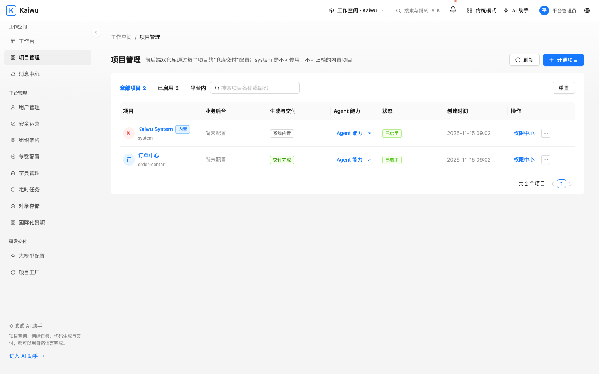
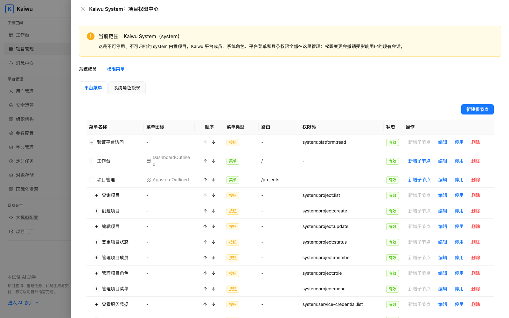
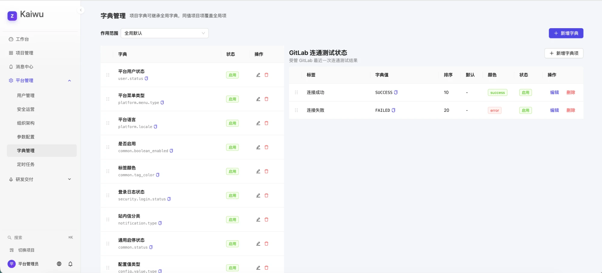
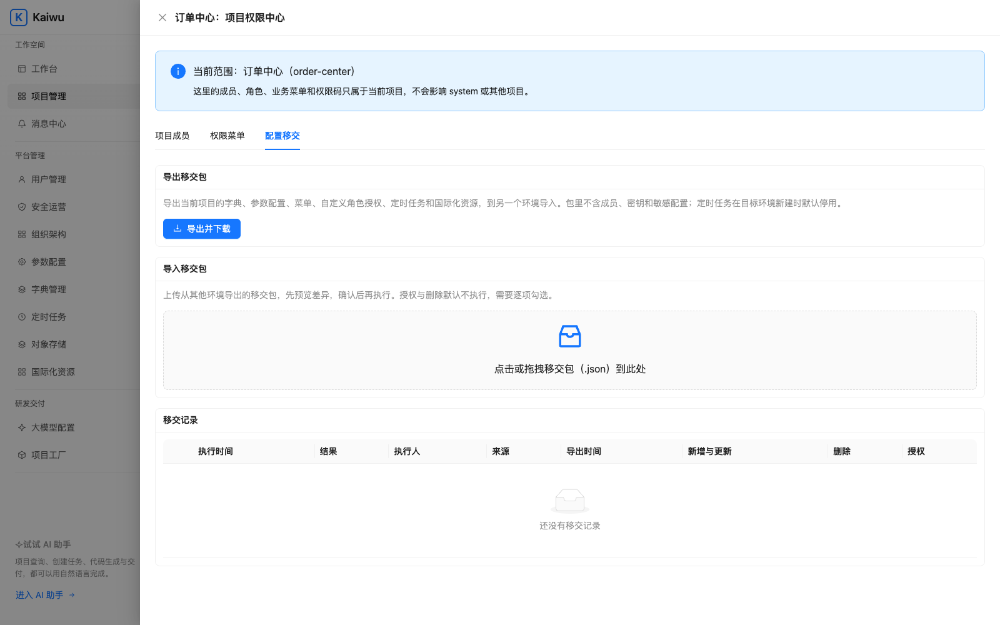
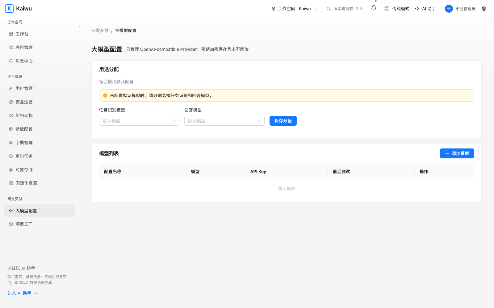

<div align="center">

# Kaiwu · 开物载道

**产品用 AI 直出正式前端，后端接完接口即上线；独立业务仓与随仓门禁，让多应用共享企业底座。**

[English](README.en.md) · [v0.3.0 发布说明](https://github.com/kaiwuzaidao/kaiwu/releases/tag/v0.3.0) · [产品前端起步仓](https://github.com/kaiwuzaidao/kaiwu-web-starter/tree/v0.3.0) · [AI 协作开发指南](docs/AI-DEVELOPMENT.md) · [10 分钟看懂机制](docs/HOW-IT-WORKS.md)

</div>

> **Kaiwu 解决什么问题？**
> 企业同时开发多个内部系统（采购、库存、设备预约、订单、审批等）时，常卡在两件事：**产品原型要前端重敲一遍**，以及 **AI 写完跨仓改漏、换人换模型就漂移**。Kaiwu 用 **「产品即前端 + 随仓门禁 + 共享薄底座」** 一次性解决。

| 产品即前端（零重写交接） | 开发可控（换人换模型不漂移） | 薄平台（多应用共享企业底座） |
| --- | --- | --- |
| 产品经理用 AI 在起步仓直接做出带多角色 `/__mock/` 演示的 **React 正式前端**；确认后 `project adopt` 纳管生成后端，同一套页面直接联调上线。 | 每个业务交付为 **独立前后端 Git 仓 + 独立库**，内置 `AGENTS.md`、编号业务规则、`acceptance-scenarios.md` 与 `verify` 门禁，提交前自动抓出漏项。 | 统一网关、单点登录、成员/角色/行级数据范围、受管字典、多语言、对象存储、统一待办与项目助手集中治理，业务代码 100% 独立演进。 |

---

## 30 秒看懂从 Mock 到生产的全链路





---

## 为什么选 Kaiwu？

| 对比维度 | Kaiwu + AI 编码工具 | 低代码平台 | 传统后台脚手架 | 单独使用 AI 工具 |
| --- | --- | --- | --- | --- |
| **前端如何到上线** | 产品直出正式 React 前端 + Mock 验收，纳管后后端直接接 API 上线，**零重写**；UI 库可换 | 拖拽表单直接发布，但复杂交互与自定义前端受限于平台扩展边界 | 产品画原型，专职前端照图重敲一遍，接口与交互反复对齐 | 很快生成一次性 Demo，但缺少鉴权、权限接入与 Mock 隔离，常需推倒重来 |
| **多系统如何共享** | 新应用接入同一网关，已有员工按项目分配角色与数据范围，工作台自动出现入口 | 同平台应用通常可复用账号与角色体系 | 复制工程后各自一套登录表，跨系统共用账号与待办需自行改造 | 每次都要把登录协议、令牌与权限表结构重新喂给 AI |
| **规则如何长期可控** | 独立小上下文仓库 + 规则/场景/Mock 绑定 + 权限三端同码门禁，换人换模型不漂移 | 依赖设计器配置，复杂逻辑调试与代码化协作受限 | 复制多个工程后各自修改，公共能力修复靠人工逐仓同步 | 权限一致性、数据库迁移、敏感日志与发布契约全靠团队手工兜底 |

---

## 快速上手：按场景选一条路线

### 产品先出前端演示

> **路线 A（推荐先试）· 无需 Docker、MySQL 或 JDK，只需要 Git、Node 22 和 pnpm 10**，5 分钟在本地跑起带角色切换与规则校验的双人设备预约演示：

<details>
<summary>复制这句话给你的 AI 编码工具（Claude Code / Codex / Cursor 等）直接开工</summary>

```text
从 https://github.com/kaiwuzaidao/kaiwu-web-starter 的 v0.3.0 标签帮我初始化一个设备预约演示项目，按仓库 AGENTS.md 运行本地 Mock，交付我能点击测试的 /__mock/ 角色切换地址。
```

</details>

或者自己在终端执行（体验内置示例加 `--example booking`，自建空白业务去掉该参数）：

```bash
git clone --branch v0.3.0 --depth 1 https://github.com/kaiwuzaidao/kaiwu-web-starter.git
cd kaiwu-web-starter
node scripts/kaiwu-init.mjs --code equipment-booking --name 设备预约 --example booking
cd ../equipment-booking-web
pnpm install --frozen-lockfile
pnpm dev
```

1. **多角色交互演示**：打开终端打印地址的 `/__mock/`，分别用不同浏览器会话选择员工甲、乙，测试预约、冲突提示、取消释放和重置内存数据。
2. **规则与 UI 解耦**：业务页面通过只读接入层 `@/kaiwu`（`useCan`、`useDict`、`useProjectConfig`、`kaiwuRequest`）对接平台，可随时更换 UI 组件库；`pnpm verify:mock` 自动校验 `docs/business-rules.md`、`docs/acceptance-scenarios.md`、`mock-support/` 与 `kaiwu/*.yml` 一致性。
3. **交接并纳管生成后端**：在 `product` 分支验收后通过 `handoff/*` 移交；开发者在已启动的平台入口仓登录执行：

```bash
./kaiwu project adopt ../equipment-booking-web
./kaiwu project adopt ../equipment-booking-web --apply
```

- 首次运行不带 `--apply` 仅预览零写入；加 `--apply` 自动登记项目、同步清单与 `roles.yml` 初始角色，并在同级目录生成配套后端 `../equipment-booking-service`（`ADOPT_FRONTEND` 模式）。
- 后端实现 API 后，在**同一个前端仓**执行 `pnpm dev:real`（同时代理 `/api`、`/{code}-api`、`/{code}-svc` 到 Gateway）联调；后续清单维护运行 `./kaiwu project sync ../equipment-booking-web`，可选 Workflow 项目运行 `./kaiwu workflow sync ../equipment-booking-web`。

---

### 启动完整平台

> **路线 B（v0.3.0）· 需要 Git、Docker（含 Compose v2）、OpenSSL 和 curl**。本机 MySQL 体验直接拉取 GHCR `amd64 / arm64` 预构建镜像（国内网络可改用 Gitee 镜像 `https://gitee.com/wujm12138/kaiwu.git`）：

<details>
<summary>复制这句话给你的 AI 编码工具，自动检查环境并引导生成双仓</summary>

```text
从 https://github.com/kaiwuzaidao/kaiwu 获取 Kaiwu v0.3.0，按 AGENTS.md 在本机启动。问我想开发什么项目，再按我的回答准备前后端。
```

</details>

```bash
git clone --branch v0.3.0 --depth 1 https://github.com/kaiwuzaidao/kaiwu.git
cd kaiwu
./kaiwu doctor
KAIWU_DB_TYPE=mysql ./kaiwu up
```

- 打开 **<http://127.0.0.1:8000>**，使用 `admin` 和终端打印的随机初始密码登录并按提示改密（`./kaiwu credentials` 可随时重看初始凭据，`./kaiwu down` 停止并保留数据）。
- 已部署平台数据库需升级到 `v0.3.0` 或使用达梦 DM8：见 [升级说明（V128）](https://github.com/kaiwuzaidao/kaiwu-system-service/blob/v0.3.0/docs/UPGRADING.md) · [数据库配置](https://github.com/kaiwuzaidao/kaiwu-system-service/blob/v0.3.0/docs/DATABASES.md) · [MySQL / DM8 初始化 SQL](https://github.com/kaiwuzaidao/kaiwu-system-service/releases/tag/v0.3.0)。

#### 生成第一个业务双仓

以 `order-center` 为例，在网页「项目管理 → 开通项目」操作，或直接用 CLI：

```bash
./kaiwu login --client "kaiwu-demo"
./kaiwu project new order-center --name "订单中心"
./kaiwu project status order-center --wait
./kaiwu project pull order-center
./kaiwu project-up ../business/order-center-service ../business/order-center-web
```



<details>
<summary>查看更多真实界面截图（项目管理、权限中心、全局字典、配置移交、模型路由）</summary>

- **项目管理**：内置 `system` 项目与业务项目统一管理入口与生成状态  
  
- **项目权限中心**：菜单树与三段式权限码，与后端 `@RequirePermission` / `kaiwu/menus.yml` 三端同码  
  
- **受管字典与数据范围**：业务保存稳定值，前端按语言下发标签  
  
- **跨环境配置移交**：导出与导入前预览新增、变更、删除和角色授权  
  
- **大模型路由配置**：PLAN 与 ANSWER 阶段模型分离绑定  
  

</details>

---

## 平台内置的企业级能力

| 能力领域 | 能做什么 | 技术文档 |
| --- | --- | --- |
| **身份、角色与行级数据范围** | 统一登录 + Gateway 60 秒签名 Context；业务端接入 MyBatis-Plus 行级过滤（本人/本部门/指定部门） | [项目接入](https://github.com/kaiwuzaidao/kaiwu-system-service/blob/v0.3.0/docs/PROJECT_ACCESS.md) · [数据范围](https://github.com/kaiwuzaidao/kaiwu-system-service/blob/v0.3.0/docs/DATA_SCOPE.md) |
| **前端纳管与清单移交** | `project adopt` 纳管产品前端、`project sync` 预览同步 `kaiwu/*.yml`、管理端跨环境配置移交 | [ADR 0048 前端纳管](https://github.com/kaiwuzaidao/kaiwu-system-service/blob/v0.3.0/docs/adr/0048-adopt-existing-frontend.md) · [项目工厂](https://github.com/kaiwuzaidao/kaiwu-system-service/blob/v0.3.0/docs/PROJECT_FACTORY.md) |
| **统一待办与站内通知** | 业务服务按 `bizKey` 推送、更新或关闭待办，处理人统一从工作台进入办理 | [统一待办契约](https://github.com/kaiwuzaidao/kaiwu-system-service/blob/v0.3.0/docs/UNIFIED_TODO.md) |
| **对象存储 (STS) 与 Excel** | 项目绑定存储账号并领取限定前缀临时凭据；单独引入开箱即用的 XLSX 导入导出与模板校验 | [Starter 与组件库](https://github.com/kaiwuzaidao/kaiwu-system-starter/tree/v0.3.0) |
| **受控项目 AI 助手** | PLAN / ANSWER 双阶段模型路由；按当前成员权限与数据范围只读查询，写操作先预览后确认 | [模型路由 ADR](https://github.com/kaiwuzaidao/kaiwu-system-service/blob/v0.3.0/docs/adr/0043-agent-multi-model-routing.md) · [跨项目能力](https://github.com/kaiwuzaidao/kaiwu-system-service/blob/v0.3.0/docs/adr/0030-agent-cross-project-capabilities.md) |

> **Java SDK 坐标（Maven Central）**：`v0.3.0` 平台沿用已发布的 `com.kaiwuzaidao` `0.2.0` 组件：`kaiwu-system-starter`、`kaiwu-data-scope`、`kaiwu-excel`。

---

## 仓库地图与延伸阅读

| 仓库 | 定位 |
| --- | --- |
| [kaiwu](https://github.com/kaiwuzaidao/kaiwu) | 统一开源入口与 CLI 编排（[Gitee 镜像](https://gitee.com/wujm12138/kaiwu)） |
| [kaiwu-web-starter](https://github.com/kaiwuzaidao/kaiwu-web-starter/tree/v0.3.0) | 产品前端起步仓（内置 `/__mock/`、规则场景检查与 `@/kaiwu` 无头接入层） |
| [kaiwu-system-service](https://github.com/kaiwuzaidao/kaiwu-system-service/tree/v0.3.0) | 控制面后端、项目工厂、前端纳管、Flyway 与 Helm Chart |
| [kaiwu-gateway-service](https://github.com/kaiwuzaidao/kaiwu-gateway-service/tree/v0.3.0) | 统一外部入口、JWT/Redis 会话校验与签名 Context 转发 |
| [kaiwu-system-web](https://github.com/kaiwuzaidao/kaiwu-system-web/tree/v0.3.0) | 平台工作台、权限中心、字典/配置/多语言与项目工厂界面 |
| [kaiwu-system-starter](https://github.com/kaiwuzaidao/kaiwu-system-starter/tree/v0.3.0) | 业务后端 SDK、行级数据范围与 Excel 工具 |
| [kaiwu-deploy](https://github.com/kaiwuzaidao/kaiwu-deploy/tree/v0.3.0) | 可选 Kubernetes / Argo CD GitOps 部署声明（`./kaiwu deploy-init`） |

- **实战与部署**：[AI 协作开发指南](docs/AI-DEVELOPMENT.md) · [10 分钟运作机制](docs/HOW-IT-WORKS.md) · [仓库与 Fork 说明](docs/REPOSITORIES.md) · [单机服务器部署](https://github.com/kaiwuzaidao/kaiwu-system-service/blob/v0.3.0/docs/SERVER-DEPLOYMENT.md) · [Kubernetes 部署](https://github.com/kaiwuzaidao/kaiwu-system-service/blob/v0.3.0/docs/KUBERNETES.md)
- **维护与规范**：[Agent 入口规范](AGENTS.md) · [版本变更](CHANGELOG.md) · [参与贡献](CONTRIBUTING.md) · [Apache-2.0](LICENSE) · [商标政策](TRADEMARKS.md)
