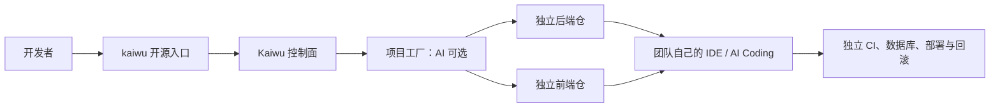

# Kaiwu · 开物载道

*中文 · [English](README.en.md)*

> 把后台项目从“能生成”带到“能理解、能验证、能长期维护”。

Kaiwu 是面向多项目交付的通用后台开发平台。它把用户、项目、权限、菜单、字典、配置、国际化、
审计、统一入口和确定性项目脚手架放在同一个治理面中，同时把每个业务项目交付为独立前后端
仓库、独立数据库和独立部署边界。

AI 不是使用 Kaiwu 的前提。你可以生成基础空脚手架，也可以让 AI 参与受约束的第一版业务蓝图；
交付之后，继续使用团队熟悉的 IDE、Codex、Claude Code、Cursor 或其他 AI Coding 工具开发。

## 5 分钟开始

只需要 Git、Docker Compose v2 和 OpenSSL：

```bash
git clone <本仓库地址> kaiwu
cd kaiwu
./kaiwu doctor
./kaiwu up
```

看到服务就绪提示后，打开 [http://127.0.0.1:8000](http://127.0.0.1:8000)。随机初始密码会显示
在终端，也可以执行：

```bash
./kaiwu credentials
```

第一次体验不需要配置 AI、Nacos、Kubernetes、ArgoCD、外部 MySQL 或 Redis。


## 选择你的路线

| 我想做什么 | 下一步 |
| --- | --- |
| 先体验平台 | `./kaiwu up`，然后按工作台引导创建基础项目 |
| 开发第一个业务项目 | 从项目工厂下载独立后端、前端 ZIP，用自己的开发工具继续 |
| 部署到一台服务器 | 读 `kaiwu-system-service` 仓的 `docs/SERVER-DEPLOYMENT.md` |
| 部署到 Kubernetes（Helm） | 读 `kaiwu-system-service` 仓的 `docs/KUBERNETES.md`，Chart 就在该仓 `deploy/helm/kaiwu` |
| 部署到 Kubernetes（GitOps） | 执行 `./kaiwu deploy-init` 取得 `kaiwu-deploy`，再按上面的指南操作 |
| 先弄懂它怎么运作 | 十分钟读完 [Kaiwu 是怎么运作的](docs/HOW-IT-WORKS.md) |
| 用 AI 编码工具接手 | 读 [AGENTS.md](AGENTS.md)——Codex、Claude Code、Cursor、Trae 都从这里开始 |
| 参与 Kaiwu 开发 | 阅读 [CONTRIBUTING.md](CONTRIBUTING.md) 和 [仓库地图](docs/REPOSITORIES.md) |

> 表中 `kaiwu-system-service` 仓的文档，执行 `./kaiwu up` 或 `./kaiwu init` 之后会出现在
> `workspace/kaiwu-system-service/docs/`；在此之前可以直接到该仓浏览同名路径。

## 一眼看懂工作方式



Kaiwu 不在生成成功后持续覆盖业务源码。平台负责提供一致的项目起点和治理契约，业务团队负责
后续设计、开发、测试、评审和发布。

想理解这套设计背后的取舍，读 [Kaiwu 是怎么运作的](docs/HOW-IT-WORKS.md)。

## 它重点解决什么

- 完整平台过重：为了一个业务项目被迫继承大量无关模块和历史约定。
- 低代码边界不清：早期很快，复杂业务出现后扩展、调试和迁移成本陡增。
- 复制脚手架持续漂移：同一组织的第一个项目和第五个项目已经不像同一套工程。
- AI 上下文窗口有限：项目和业务事实混在巨型仓库中，检索面过大，修改更容易遗漏。
- AI 生成物能跑但不能交付：缺少权限、迁移、日志、安全、CI 和部署契约。
- 平台与业务代码纠缠：升级平台时担心覆盖业务，业务变化又反向拖住平台。

Kaiwu 用“薄平台、独立业务仓、受约束蓝图、确定性模板、可执行工程门禁”回应这些问题。


项目工厂对每个项目只生成一次。拿到独立的前后端仓库后，Kaiwu 不会再覆盖你的业务源码。

## 国际化不是复制一套页面

Kaiwu 平台首批完整支持中文和英文。语言偏好保存在用户账号中，换浏览器登录仍能恢复；切换语言
不需要重新登录。固定界面、API 提示、动态菜单和全局字典使用同一套语言目录与回退规则，不让每个
页面各自维护一份翻译逻辑。

| 常见问题 | Kaiwu 的处理方式 |
| --- | --- |
| 页面翻译了，接口错误和动态菜单仍是另一种语言 | Gateway、System、Starter 使用稳定 `messageKey`，菜单和字典按用户语言返回 |
| 新增一种语言后出现半中文、半外文 | 只有必需资源、内置菜单和全局字典全部覆盖后，语言才会开放给用户 |
| 翻译影响权限判断或接口兼容 | 显示文本与权限码、字典值、状态码、ID 和 Context 协议严格分离 |

这里的边界同样明确：这是 Kaiwu 控制面的国际化能力。已经交付的业务仓库不会被平台回写；业务项目
需要哪些语言，由业务团队在自己的仓库中继续设计和维护。

## 仓库不是一个大杂烩

这个入口自身不保存产品源码。第一次运行后，`workspace/` 中会出现四个运行仓；选择 Kubernetes/
GitOps 时再加入第五个部署仓。它们始终是相互独立的 Git 仓库：

```text
workspace/
├── kaiwu-system-service       # 控制面、统一启动入口、Helm Chart
├── kaiwu-gateway-service      # 唯一外部 API 入口
├── kaiwu-system-web           # 平台管理前端
├── kaiwu-system-starter       # 业务服务接入 SDK
└── kaiwu-deploy               # 可选：执行 deploy-init 后加入
```

`workspace/` 被本入口忽略，不会形成嵌套提交。这里不要求 submodule：普通用户通过脚本获得同版本
工作区，产品维护者仍在各自仓库独立提交、测试和发布。

## Fork、自建 Git 与版本

入口和产品仓正式发行时使用同名 tag。Fork 或自建 Git 服务可以显式覆盖：

```bash
export KAIWU_REPOSITORY_BASE_URL='https://github.com/kaiwuzaidao'
export KAIWU_REPOSITORY_REF='v0.1.0'
./kaiwu repositories
./kaiwu up
```

入口不会覆盖已存在的仓库或切换用户分支。实际产品仓 commit 会由 System 启动器记录到
`workspace/.kaiwu/workspace.lock`，便于复现问题。

## 项目哲学

1. 业务项目必须能离开平台独立开发和部署。
2. AI 可以参与设计，但不是创建项目或后续开发的强制工具。
3. 模型产生受校验的蓝图，源码和工程文件由版本化模板确定性渲染。
4. 权限、数据库迁移、日志、安全、CI 和部署不是生成之后再补的附件。
5. 面向用户的显示可以变化，权限码、状态码和服务协议必须保持稳定。
6. 只做开发者能够理解、验证和维护的能力。

## License

Kaiwu 入口与产品仓统一采用 [Apache License 2.0](LICENSE)。
