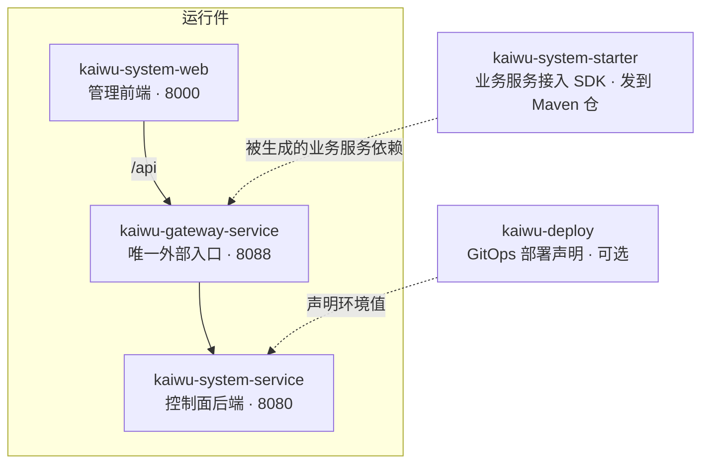
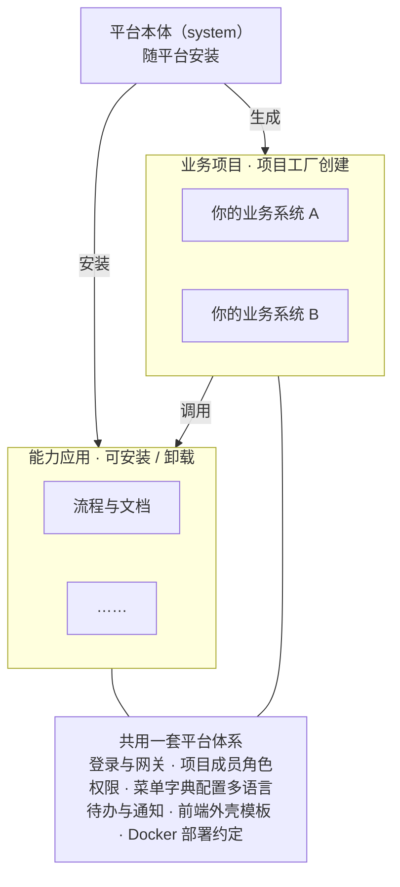

# Kaiwu 是怎么运作的

十分钟读完，用来判断 Kaiwu 是否适合你的团队。

这是**导览**，不是规范。每一节末尾都指向真正的事实源；出现分歧时以产品仓文档为准。

## 五个仓，各自独立

Kaiwu 不是一个大仓库。你现在看到的入口只有主页、初始化脚本和导航，产品源码在五个
独立仓库里，各自有自己的 Git 历史、CI、版本和发布节奏。



前三个是进程，`kaiwu-system-starter` 是给业务服务用的 SDK（不是运行进程），
`kaiwu-deploy` 只在你走 Kubernetes/GitOps 时才需要。

> 详见 [仓库地图](REPOSITORIES.md)

## 一个请求怎么走

理解 Kaiwu 的最快方式是跟着一个请求走一遍：

1. 浏览器请求 `/api/projects`，打到 **Web** 的 nginx
2. nginx 把 `/api` 反代给 **Gateway**（前端不直连后端，这条是硬约束）
3. Gateway 验证 Access JWT 与 Redis 里的在线会话
4. Gateway 按 Route 声明的访问模式决定策略；若是业务项目接口，还要向 System 确认
   调用者确实是该项目的有效成员
5. Gateway 签发一枚 **60 秒、绑定目标服务 audience** 的内部 Context，转发请求
6. **System** 或业务服务用 Starter **本地验证**这枚 Context，不再回头询问平台

第 6 步是关键：正常业务请求**不会**产生"业务服务 → 平台"的同步调用。平台不会成为
每个业务请求的性能瓶颈和故障点。

## 三条边界

Kaiwu 的多数设计可以归结为三条边界，它们解释了为什么架构长这样。

**① Gateway 不持有权限事实**

Gateway 只做身份、会话、项目成员三件事，没有数据库连接，不执行业务规则。
权限的唯一事实源是 System。这样做的代价是 Gateway 需要向 System 查项目授权（带缓存），
换来的是不会出现两套会漂移的权限数据。

**② Kaiwu 自己也是一个项目**

平台的成员、角色、菜单、登录权限，全部存在一个 `project_code=system` 的内置项目下，
和业务项目走完全相同的表和相同的授权路径。没有"平台专用"的特权旁路。


上图里 `Kaiwu System` 和两个业务项目在同一张列表、同一套操作入口下。区别只有一处：
它标着"内置"，停用与归档是灰的——平台自身不能被自己停用，其余一视同仁。

**③ 生成的项目必须能离开平台**

项目工厂对每个项目**只生成一次**，产出独立的前后端仓库、独立数据库、独立部署边界。
生成完成后 Kaiwu 不再碰业务源码——你用自己的 IDE、自己的 AI 工具、自己的 CI 继续开发。
平台升级不会覆盖你的业务代码，你的业务变化也不会反向拖住平台。


上图是一个业务项目的权限菜单：菜单树、按钮和 `mod:res:act` 权限码在同一处维护，
后端注解、前端按钮与菜单 SQL 使用同一个权限码，由 CI 校验三处一致。

> 详见各产品仓的 `docs/ARCHITECTURE.md` 与 ADR 目录

## AI 在哪一步

项目工厂按项目配置生成基础脚手架。业务功能由团队在取回的仓库中开发，团队可以选择自己的 IDE 或 AI 编码工具。

```
项目编码、名称和基础包名等配置
        ↓
   确定性模板渲染基础源码与工程文件
        ↓
   取回独立前后端仓库
        ↓
   团队使用 IDE 或 AI 编码工具开发业务功能
        ↓
   运行项目自带的校验与测试
```

当前创建入口使用 `BASIC_SCAFFOLD`。可以通过
`./kaiwu project new order-center --name "订单中心"` 创建，再用 `project status` 查看进度、
`project pull` 取回两个仓库。

平台模板提供鉴权接入、工程结构和校验入口。后续开发遵循业务仓的 `AGENTS.md`，
由团队维护数据模型、业务逻辑、权限清单和测试，并按需合并模板升级。

> 详见 `kaiwu-system-service/docs/PROJECT_FACTORY.md` 与 ADR 0038。

## 三类项目，一套体系

Kaiwu 里的每个东西都是一个「项目」，按来源和生命周期分三类。三类项目的区别只在怎么来、怎么下线、是否跨项目；
除此之外，它们站在同一套平台体系上，不允许各自另做一套。



| | 平台本体 | 能力应用 | 业务项目 |
|---|---|---|---|
| 怎么来 | 随平台安装 | 从平台发行版内置的应用目录安装 | 项目工厂生成源码，团队接手开发 |
| 怎么下线 | 不可停用或删除 | 可停用、卸载；数据默认保留，重装可恢复 | 走项目归档 |
| 两级操作 | — | 先在平台**安装**一次（管理端、菜单、目录登记），再给具体业务项目**启用**（登记该项目、配好双方凭据与路由；选独占时另起一套实例） | — |
| 代码归属 | Kaiwu | Kaiwu 维护，使用者只升级版本 | 你的团队 |
| 服务对象 | 整个平台 | 供业务项目按需启用；默认一套实例服务所有启用的项目，数据按项目隔离，隔离要求高的项目可选独占实例 | 只服务自己 |
| 权限 | 平台权限 | 本应用权限，加上对目标业务项目的授权 | 本项目权限 |

**共用的部分**（三类都必须遵守）：

- 统一登录，一切请求走 Gateway；
- 同一个项目模型：成员、角色、菜单、权限码（平台自身也是一个项目）；
- 菜单、字典、配置、多语言用同一套清单和同步方式；
- 统一待办与站内通知；
- 前端用项目工厂模板的同一套外壳：侧栏、顶部操作栏、权限按钮、字典组件；
- 同一套 Docker 部署约定（`compose.yml` + 网关路由声明）。

所以一个能力应用装进来以后，看起来、用起来都和平台本身一致；业务项目接入某个能力，也只是调用它，不需要理解另一套规则。

> 状态：分类和共用体系是当前约定。能力应用的一键安装与卸载（`kaiwu app install` / `uninstall`）正在设计，第一期只支持 Docker，相应 ADR 发布后在此补链接。

## 生成出来的项目长什么样

不是一个空壳。每个生成的后端仓库自带：

- 三模块结构、分页边界、统一异常与响应
- Flyway 迁移脚本与权限菜单 SQL
- 接入 Starter 的鉴权、字典、配置、站内信、定时任务
- 约定测试（架构依赖、分页上限、敏感日志、API 兼容基线）
- `CLAUDE.md` 与 `AGENTS.md`，写明路径、构建命令、权限/字典/Context 契约和常见坑

最后一条是给 AI Coding 工具准备的：你的团队接手后继续用 Claude Code、Codex 或 Cursor
开发时，这些文件让工具知道该守什么规矩。

## 工程约束是可执行的

Kaiwu 把权限三端同码、字典使用、迁移前向性、分页上限、敏感日志、服务寻址等约束
写成了 CI 门禁，而不是文档里的建议。约束目录在
`kaiwu-system-service/docs/kaiwu-constraints.json`，每条都标注了强度、理由和执行方式。

这意味着违反约定的代码**会让构建变红**，而不是等到 code review 或线上事故。


字典是其中一例：需要翻译或运营配置的业务状态统一走字典组件，新增受管字典必须
后端 seed 与前端 fallback 同批提交，由 `pnpm check:dict` 校验。

> 详见 ADR 0020「风险分级的工程约束」

## 国际化怎样保持一致

Kaiwu 不把国际化理解成前端里多放几份 JSON。用户语言偏好保存在 System，换浏览器登录可以恢复；
固定界面、跨服务错误、动态菜单和全局字典沿同一语言目录工作。Gateway、System 和 Starter 返回
稳定的 `messageKey/messageArgs`，翻译不会改变状态码、权限码、字典值、19 位 ID 或 Context。

初始完整语言是 `zh-CN` 和 `en-US`。新语言只有在必需资源、内置菜单和全局字典全部覆盖后才会
出现在选择器中，避免把“能够选择”误当成“已经可用”。资源加载失败时保留上一份完整快照，不因
翻译服务异常清除会话或写入不完整偏好。

国际化也遵守业务所有权边界：平台不会把语言资源回写到已经生成成功的业务仓。业务项目需要支持
哪些语言、字段和内容，由业务团队在自己的前后端仓库中持续维护。

> 详见 `kaiwu-system-service/docs/REQUIREMENTS.md` 4.9 与 ADR 0011

## 接下来

| 你想 | 去哪 |
|---|---|
| 跑起来看看 | 回到 [主页](../README.md) 的「5 分钟开始」 |
| 了解仓库怎么分工 | [仓库地图](REPOSITORIES.md) |
| 读完整架构设计 | `kaiwu-system-service/docs/ARCHITECTURE.md` |
| 看每个决策的来龙去脉 | `kaiwu-system-service/docs/adr/` |
| 参与开发 | [CONTRIBUTING.md](../CONTRIBUTING.md) |
