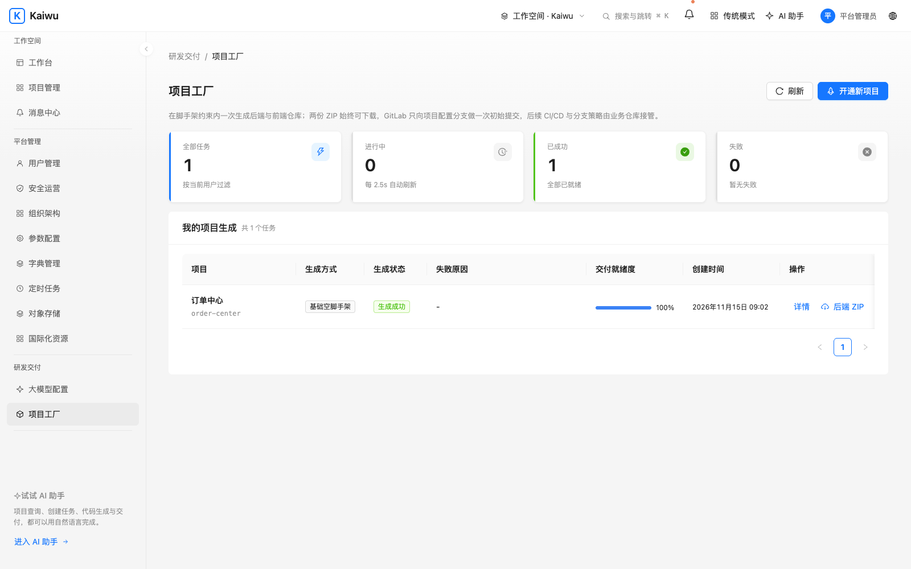
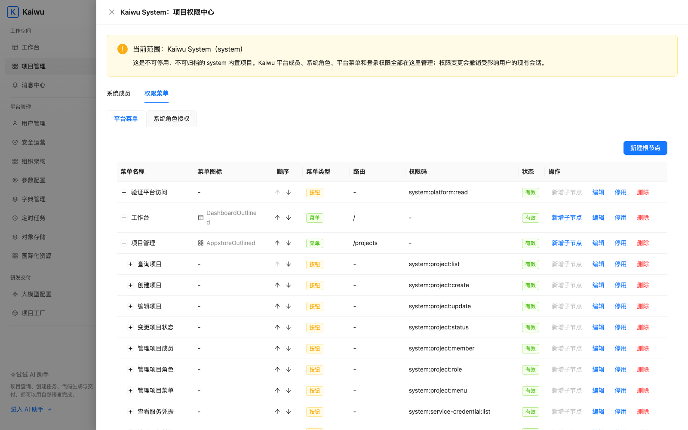
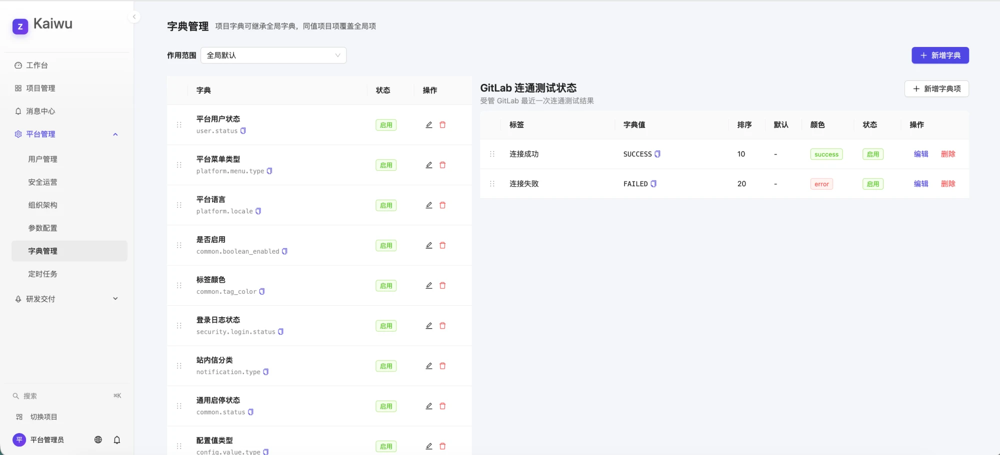
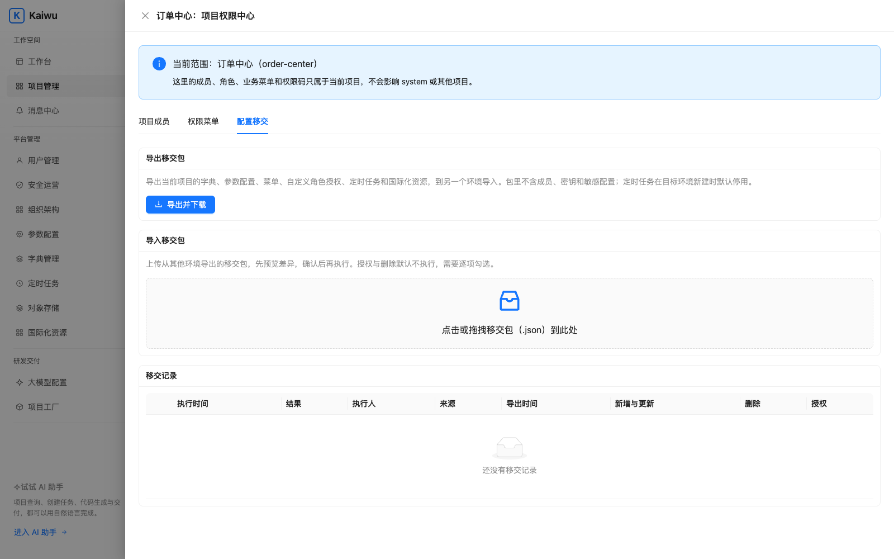
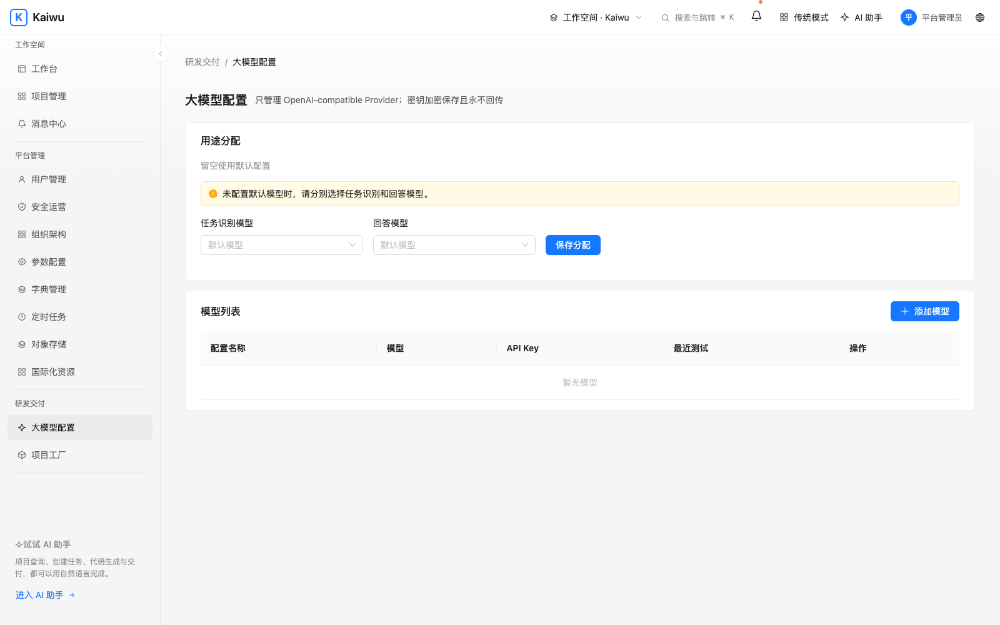

# 从订单中心看 Kaiwu v0.3.0

如果你的团队要做一个订单后台，可以先在 Kaiwu 开通项目。平台管理谁能进入后台，项目工厂给出可运行的前后端起点；订单表、定价规则和履约流程由业务团队在自己的仓库中开发。下面的截图取自 MySQL 空库启动的公开版本，示例项目为 `order-center`。

## 从开通项目到接手源码

在工作台点「开通项目」，填写项目名称和编码。生成任务完成后，「项目工厂」提供后端 ZIP 和前端 ZIP。也可以用 CLI 生成并取回两个 Git 仓库，命令见[首页的完整示例](../README.md#生成第一个业务双仓)。



每个项目编码只生成一次。业务团队在独立仓库里维护表结构、菜单声明、接口和测试。生成的后端提供 Flyway 迁移、Starter 接入和权限检查；前端提供应用外壳、菜单、字典和权限组件。本机用 `project-up` 接入后，成员可从工作台打开业务后台。[项目工厂与交付方式](https://github.com/kaiwuzaidao/kaiwu-system-service/blob/v0.3.0/docs/PROJECT_FACTORY.md)

## 成员能进哪个项目，能看哪些数据

「项目管理」同时列出平台内置项目 `system` 和订单中心。打开哪一行的「权限中心」，就在哪个项目内管理成员、角色和菜单。图中订单中心的代码已经生成，业务后台地址还没有配置。


下图是内置项目的权限菜单，其中有工作台等菜单，也有具体操作的权限码。业务项目使用同一套模型，在自己的后端仓维护 `kaiwu/menus.yml`；前端按钮可见性和后端操作校验共用权限码。



浏览器通过 Web 访问 Gateway。Gateway 验证登录会话、确认项目访问权限，再签发绑定目标服务的短期 Context。业务服务用 Starter 本地验证 Context。需要限制记录范围时，管理员可按角色和资源选择「仅本人」「本部门」等范围，业务端声明要保护的表，再接入 `kaiwu-data-scope`。[项目接入](https://github.com/kaiwuzaidao/kaiwu-system-service/blob/v0.3.0/docs/PROJECT_ACCESS.md) · [数据范围配置与接入](https://github.com/kaiwuzaidao/kaiwu-system-service/blob/v0.3.0/docs/DATA_SCOPE.md)

## 让配置跟着项目走

项目字典可以继承全局默认项。图中左侧选中了「数据范围类型」，右侧列出标签和稳定的字典值。用户看到的中文或英文可以变化，代码通过字典值判断业务状态。



开发时，先在业务后端仓维护菜单、字典、参数和多语言清单，再预览将要写入的内容：

```bash
./kaiwu project sync ../business/order-center-service
./kaiwu project sync ../business/order-center-service --apply
```

跨环境时，在项目权限中心打开「配置移交」。源环境一次导出包含字典、参数默认值（自动跳过敏感项）、菜单、自定义角色授权与 `dataScopes`、定时任务及项目多语言在内的 6 类 YAML 全量快照，全部按业务键对齐而非数据库主键；目标环境导入时基于「上次移交基线 × 本次包 × 目标当前状态」做三方比对预览与 409 并发守卫，角色授权默认关闭，按组确认；源端删除逐项勾选，新建定时任务默认停用，成员和密钥留在各自环境，导出的 YAML 也可直接写回业务仓。[配置移交规则](https://github.com/kaiwuzaidao/kaiwu-system-service/blob/v0.3.0/docs/adr/0042-project-config-handover.md)



## 让业务事件与安全存储回到统一底座

假设订单需要复核，业务服务可通过 `TodoClient` 按业务键向处理人投递待办（原生支持或签、会签、撤回和逾期置顶），复核完成或订单撤销时由业务服务关闭或取消待办，工作台随之更新。成员从待办进入对应项目，业务状态仍由订单中心维护。[统一待办接入示例](https://github.com/kaiwuzaidao/kaiwu-system-service/blob/v0.3.0/docs/UNIFIED_TODO.md)

有附件的项目可绑定对象存储。长期密钥加密留在 System，业务服务只领取 `{bucket}/{projectCode}/*` 前缀的短期 STS 临时凭据，文件字节直连存储不经 System 中转，业务库只保存 `storage_ref` 与 `object_key`（切换存储账号或桶时，保留原绑定即可读取旧文件）；还可按需启用统一文件台账 `kaiwu_file`、孤儿清理任务，以及防公式注入与 ZIP 炸弹的安全 `kaiwu-excel`。[项目对象存储](https://github.com/kaiwuzaidao/kaiwu-system-service/blob/v0.3.0/docs/adr/0039-project-object-storage-via-sts.md)

平台控制面在首次安装时还原生支持选择 **MySQL 或国产达梦 DM8**（配备独立 `kaiwu-dm-migrator` 迁移容器与实例参数预检）。[数据库配置](https://github.com/kaiwuzaidao/kaiwu-system-service/blob/v0.3.0/docs/DATABASES.md)

## 助手如何选择模型

管理员在「大模型配置」添加兼容的提供方，再分配任务识别模型和回答模型。已有默认配置时，两种用途均可复用它。下图是新安装的实际状态，尚未接入模型。



助手支持个人对话和已审核的项目能力。查询按用户对目标项目的授权执行；涉及写入时，用户先确认操作。项目工厂生成基础脚手架可以独立运行。[模型用途分配](https://github.com/kaiwuzaidao/kaiwu-system-service/blob/v0.3.0/docs/adr/0043-agent-multi-model-routing.md) · [跨项目能力](https://github.com/kaiwuzaidao/kaiwu-system-service/blob/v0.3.0/docs/adr/0030-agent-cross-project-capabilities.md)

[启动平台](../README.md#启动完整平台) · [查看产品仓](REPOSITORIES.md)
